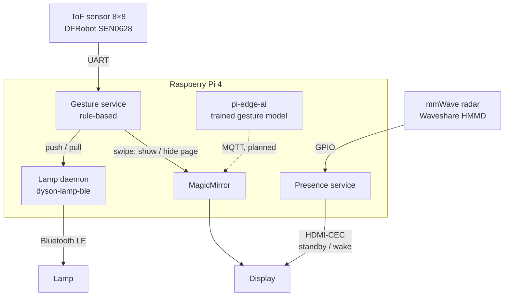

# Tobias Kapfhammer

**Systems engineer in Munich.** Requirements, verification and release decisions for safety-relevant embedded systems at CARIAD, BMW and Audi.

In my own time I build small systems end to end and write down why they are built the way they are. Two of them already run together on one Raspberry Pi behind a smart mirror; the third, pi-edge-ai, is joining them.

## How it fits together

A mmWave radar wakes the display when someone is in front of the mirror. A camera-free time-of-flight sensor picks up hand gestures: a swipe shows or hides a page, a push or pull switches a lamp over Bluetooth LE. A trained gesture model from pi-edge-ai is the next step and will reach the mirror over MQTT (dashed).

## Projects

**[pi-edge-ai](https://github.com/bikenthusiast/pi-edge-ai)** · Python, LiteRT, SQLite, MQTT  
Machine learning on a Raspberry Pi: image classification turned into clean events, and a gesture pipeline that will replace the mirror's rule-based recognition.  
*Shows:* benchmarks under documented conditions that keep model agreement apart from accuracy, Architecture Decision Records, a versioned event schema, deployment only after the tests pass.

**[dyson-lamp-ble](https://github.com/bikenthusiast/dyson-lamp-ble)** · Python, Bluetooth LE, GitHub Actions  
Local control of a Bluetooth LE lamp: the protocol analysed and re-implemented for interoperability.  
*Shows:* a written interface specification, a secure challenge / response handshake, cryptography checked against official RFC and NIST test vectors.

**[raspberrypi-magicmirror](https://github.com/bikenthusiast/raspberrypi-magicmirror)** · Python, systemd, UART, GPIO  
The smart mirror that ties it together: mmWave presence detection and camera-free gesture control.  
*Shows:* sensor choices documented as decision records (privacy ruled out a camera), a reproducible rebuild from one bootstrap script, hardened services, secrets kept out of Git.

**[airgap-k8s-lab](https://github.com/bikenthusiast/airgap-k8s-lab)** · Kubernetes, Shell, PKI  
A four-node Kubernetes cluster built from scratch without internet access.  
*Shows:* an own certificate authority and registry, deliberate failure injection, an error journal per exercise.

## Background

- **CARIAD SE**, since 2023: Systems Development Engineer. Traceability for 100+ requirements in IBM DOORS, release recommendations, test automation that cut commissioning runs from five days to one
- **BMW** and **Audi**, 2020–2023: field validation of a driver assistance function; a Hardware-in-the-Loop test bench built and commissioned
- **Technical University of Munich**: M.Sc. Automotive Engineering, B.Sc. Mechanical Engineering and Management
- Certified in software architecture (iSAQB CPSA-F) and software testing (ISTQB CTFL)

## Contact

[Tobias Kapfhammer on LinkedIn](https://linkedin.com/in/tobias-kapfhammer-tum)
